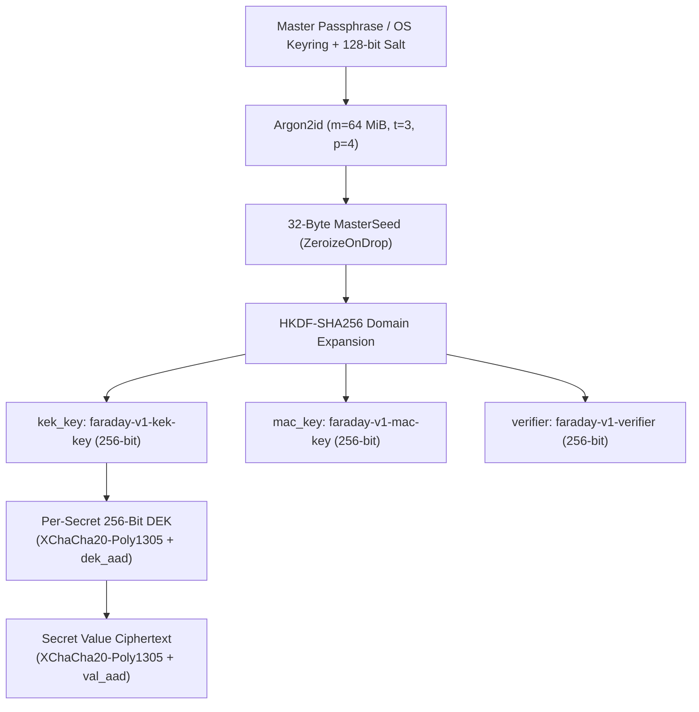

# Faraday Architecture (`faraday-cage v0.1.0`)

> Or: how to stop your own laptop from grassing you up to a language model.

---

## 1. The Threat Model, Stated Without Comforting Lies

There are two ways your secrets escape during AI-assisted development, and both of them are your fault:

1. **The `.env` file on disk.** Every process running as you can read it. That includes your coding agent, every MCP server you installed because a stranger on the internet called it "game-changing," and whichever `postinstall` script a bored teenager slipped into a dependency nine levels down your lockfile. A plaintext `.env` file isn't configuration. It's a buffet with a sneeze guard made of hope.
2. **The output pipe.** Even if you inject secrets properly, the first time a test fails, somebody runs `printenv`, a stack trace dumps the environment, or a verbose HTTP client helpfully logs the `Authorization` header. That output goes to your terminal, your CI log, and then straight into a cloud LLM's context window, where it lives forever in the warm embrace of somebody else's retention policy.

**Faraday** closes both doors: **two-tier envelope encryption at rest** and a **cancel-safe, 4-encoding SIMD redaction cage in flight**. Nothing plaintext touches the disk, and nothing secret leaves the child process's output pipes intact.

---

## 2. The Key Hierarchy (`src/crypto/mod.rs`)

Your passphrase goes through `Argon2id` at 64 MiB of memory, three passes, four lanes. That's deliberately slow and expensive, because the alternative is a GPU farm guessing your dog's name in an afternoon.

- **Two tiers, because one is a single point of failure.** Every secret gets its own freshly generated 256-bit Data Encryption Key. That DEK encrypts the value, and the KEK wraps the DEK. The DEK is zeroized on the stack the instant it's done, which is more closure than most of us get.
- **Contextual AAD binding.** The wrapped DEK is bound to `faraday-v1|{scope}|{key_name}|dek` and the value to `faraday-v1|{scope}|{key_name}|val`. If an attacker with write access to `faraday.db` copies the ciphertext of `STRIPE_SECRET_KEY` into the row for `PUBLIC_APP_NAME`, hoping your app prints it on the homepage, Poly1305 refuses to authenticate it. The database can be vandalised. It can't be made to lie.
- **Constant-time verifier.** Passphrase checks use `constant_time_eq_32`, so you can't learn the right answer by timing how quickly the wrong one gets rejected.

---

## 3. The Vault (`src/vault/mod.rs`)

A bundled SQLite WAL database with three tables and no sense of humour:

| Table | What Lives There |
| :--- | :--- |
| `faraday_meta` | The KDF salt and the 256-bit passphrase verifier. No keys. Ever. |
| `scoped_secrets` | `(scope, key_name, wrapped_dek, ciphertext, blake3_tag, updated_at)`. Plaintext is not a column. |
| `redaction_audit_log` | Every leak the cage intercepted: when, which scope, which command, which stream, which key, which encoding. A record of every time something tried to snitch. |

Every write runs inside `BEGIN IMMEDIATE`, so concurrent processes queue up instead of quietly corrupting each other (`CWE-362`). `PRAGMA secure_delete = ON` zeroes freed pages so deleted secrets don't loiter in the file like ghosts at a crime scene. The vault directory, `faraday.db`, `faraday.db-wal`, and `faraday.db-shm` are all locked to the current user (`icacls /inheritance:r` on Windows, `0700`/`0600` on Unix). If the permission change fails, Faraday refuses to open (`CWE-732`), because a security tool that shrugs off a failed lockdown is just a placebo with a CLI.

---

## 4. The Cage (`src/cage/mod.rs`)

When you run `faraday run --scope <scope> -- <cmd>`, this happens in order:

1. **Environment hygiene.** Faraday strips its own control variables (`FARADAY_PASSPHRASE`, `FARADAY_DB_PATH`) plus the companion-tool variables (`LOOM_*`, `SIGNET_*`) from the child environment (`CWE-526`). The child gets the secrets it asked for, not the key to the building. Pass `--isolate-env` and it goes further: the inherited environment is cleared completely and only a safe OS baseline (`PATH`, `SYSTEMROOT`, `TEMP`, `HOME`, and friends) is restored.
2. **Injection.** The decrypted scope secrets go straight into the child's environment block. The parent's plaintext copies are cleared right after `spawn()`. They existed in RAM for about as long as a politician's principles.
3. **The automaton.** For every injected secret of 4 bytes or more, `FaradayRedactor` compiles a `LeftmostLongest` SIMD Aho-Corasick automaton holding five spellings of it:
   - `raw`: the value itself
   - `base64`: standard alphabet
   - `base64url`: URL-safe, unpadded
   - `hex`: lowercase and uppercase
   - `url`: RFC 3986 percent-encoding (unreserved `A-Z a-z 0-9 - _ . ~` left alone, everything else escaped)
4. **The guillotine.** Child `stdout` and `stderr` are read concurrently through `CancelSafeLineReader`, which keeps its partial-line buffer inside the struct so a cancelled `tokio::select!` branch can't drop half a line on the floor. Lines are capped at 4 MiB (`CWE-770`). Any match becomes `[FARADAY:REDACTED:<KEY_NAME>:<BLAKE3_TAG>]` and an audit row is written. Writes to your terminal time out after 10 seconds, and the child is reaped on every exit path, so no zombies, no orphans, and no awkward conversations.

The `BLAKE3_TAG` is an 8-character keyed fingerprint of the secret. You can tell which value leaked without anyone, least of all your logs, learning what it was.

---

## 5. Known Limits (Because Pretending Otherwise Is How Breaches Happen)

- **The child process has the secret.** That's the point of injecting it. If the child deliberately exfiltrates over the network, Faraday can't stop it. Faraday guards disk and output pipes, not the child's conscience.
- **Exotic encodings get through.** ROT13, gzip-then-base64, splitting the secret across two lines, or printing one character at a time will beat a five-spelling automaton. If your dependencies are doing that, you don't have a leak problem, you have a hostage situation.
- **Secrets shorter than 4 bytes aren't redacted.** Matching single characters would redact half the alphabet. If your production password is 3 characters long, Faraday is not your biggest problem.
