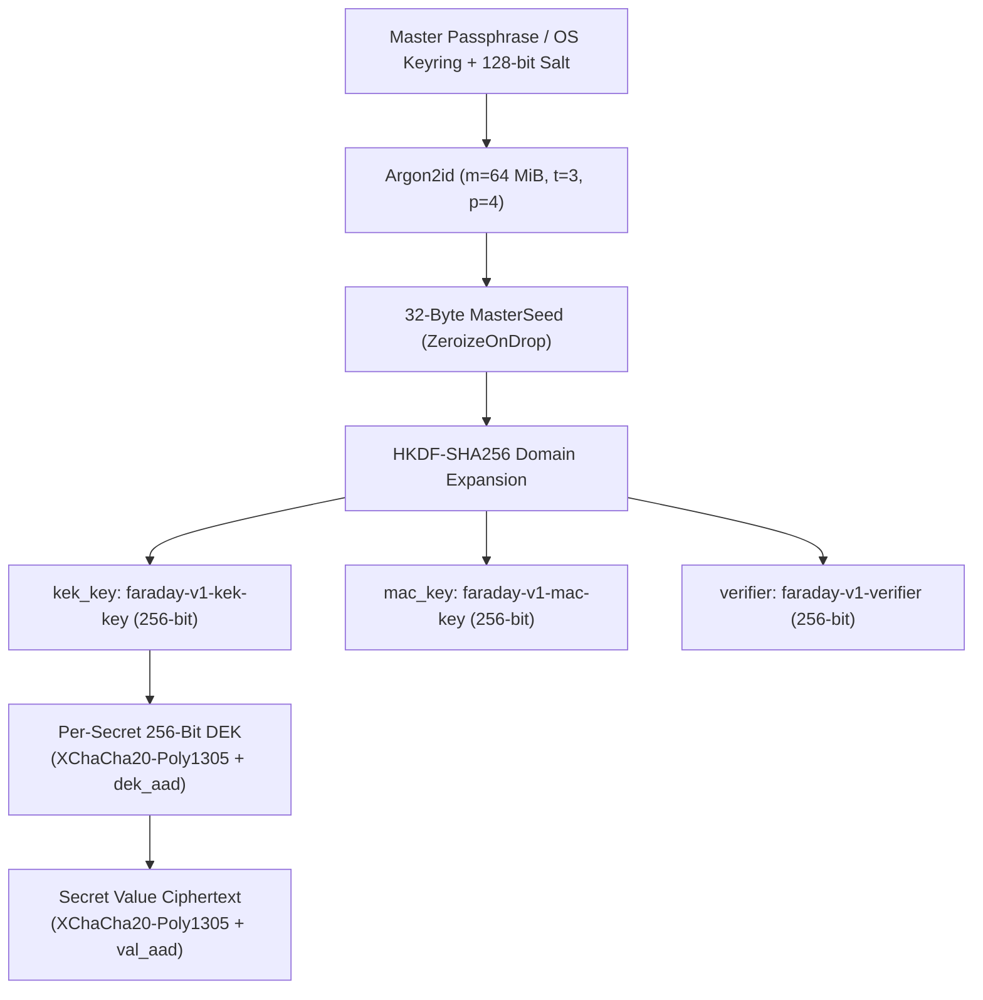

# Faraday Architecture Specification (`faraday-cage v0.1.0`)

## 1. Threat Model & Design Goals

Plaintext `.env` files on disk and unredacted child process `stdout`/`stderr` streams are the primary vectors for accidental credential disclosure during AI-assisted software development:
1. **Disk-Resident `.env` Exposure:** Any process, MCP server, or dependency build script running under the developer's OS account can read `.env` files directly from the workspace.
2. **Stdout/Stderr Context Leakage:** Even when secrets are injected via environment variables, diagnostic commands (`printenv`, stack trace dumps, verbose HTTP debuggers, or `base64`/`hex` encoders) frequently echo secret values into terminal logs that are subsequently sent to cloud LLMs.

**Faraday** eliminates both vectors via **Two-Tier Envelope Encryption (`XChaCha20-Poly1305`)** at rest and a **Cancel-Safe 4-Encoding SIMD `Aho-Corasick` Stream Redaction Cage** in flight.

---

## 2. Two-Tier Cryptographic Key Hierarchy (`src/crypto/mod.rs`)

- **Contextual AAD Binding:** Both the wrapped DEK (`faraday-v1|{scope}|{key_name}|dek`) and the secret value ciphertext (`faraday-v1|{scope}|{key_name}|val`) bind the scope and variable name into the Poly1305 authentication tag, preventing cross-row or cross-scope ciphertext substitution.

---

## 3. Live 4-Encoding Stream Redaction Cage (`src/cage/mod.rs`)

When `faraday run --scope <scope> -- <cmd>` executes:
1. **Environment Scrubbing & Injection:** Strips `FARADAY_*`, `LOOM_*`, and `SIGNET_*` control variables (or clears the environment down to `SAFE_OS_ENV_ALLOWLIST` when `--isolate-env` is passed), injects the decrypted `<scope>` secrets into the child's environment, and zeroizes the parent's plaintext vector immediately after `spawn()`.
2. **4-Encoding Automaton:** For every injected secret (`len >= 4`), `FaradayRedactor` compiles a `LeftmostLongest` SIMD `Aho-Corasick` automaton containing its `raw`, `base64` (`STANDARD`), `base64url` (`URL_SAFE_NO_PAD`), `hex` (lowercase and uppercase), and `url` (percent-encoded) representations.
3. **Cancel-Safe Multiplexing:** Reads child `stdout` and `stderr` concurrently via `CancelSafeLineReader` (`MAX_STREAM_LINE_BYTES = 4 MiB`), replacing any match with `[FARADAY:REDACTED:<KEY_NAME>:<BLAKE3_TAG>]` and recording an audit entry in `redaction_audit_log`.
