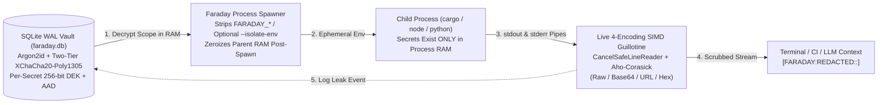

# Faraday (`faraday-cage` v0.1.0)

[](https://github.com/tsiscoe/Faraday/actions/workflows/ci.yml)
[](LICENSE)
[](Cargo.toml)
[![Safety: #![forbid(unsafe_code)]](https://img.shields.io/badge/unsafe-forbid-success.svg)](src/lib.rs)

**Faraday** (`faraday-cage`) is a pure-Rust (`#![forbid(unsafe_code)]`) process secret vault and live output redactor: it keeps your `.env` off the disk and out of the AI's reach, injects secrets directly into child process RAM, and guillotines secret leaks mid-pipe across raw, Base64, URL, and Hex encodings.

---

## Why Does Faraday Exist?

Let's be honest about what a `.env` file actually is: it is a plaintext suicide note sitting in the root directory of your repository, waiting for a hallucinating AI coding agent, an untrusted MCP server, or a malicious `npm postinstall` script to read it and upload your life savings to a crime syndicate. Putting `.env` in `.gitignore` and thinking you're safe from local coding agents is like putting a "Do Not Enter" sign on an unlocked liquor cabinet in a frat house.

And even if you inject secrets from a password manager into your shell, the very next thing your junior developer — or your autonomous AI agent — does when a test fails is run `printenv` or `console.log(process.env)`, dumping every production credential straight into the terminal scrollback and the cloud LLM's context window.

**Faraday** (`faraday-cage v0.1.0`) solves both problems by treating the disk and the child process's output pipes as hostile territory:

1. **Zero-Disk Two-Tier `XChaCha20-Poly1305` Vault (`faraday import --shred`):** Absorbs your shameful plaintext `.env` file into an `Argon2id` (`64 MiB`) + `HKDF-SHA256` + Two-Tier `XChaCha20-Poly1305` SQLite WAL vault (`faraday.db`), where every individual secret gets its own 256-bit `DataEncryptionKey` (`DEK`) bound to contextual AAD (`faraday-v1|<scope>|<key>|val`), and then overwrites the `.env` file on disk with `0x00` bytes (`sync_all`) before deleting it.
2. **Ephemeral Process Memory Injection (`faraday run`):** Decrypts your scoped secrets (`dev`, `staging`, `prod`) directly into the environment block of a single spawned child process (`faraday run --scope dev -- cargo test`), strips Faraday's own master variables (`FARADAY_PASSPHRASE`, `FARADAY_DB_PATH`) so the child can't unlock the vault itself, and immediately zeroizes the parent's plaintext copies in RAM.
3. **Live 4-Encoding SIMD `Aho-Corasick` Output Guillotine:** Wraps the child's `stdout` and `stderr` pipes in a cancel-safe `CancelSafeLineReader` (`4 MiB` cap) and a SIMD `Aho-Corasick` (`LeftmostLongest`) redactor armed with every injected secret's **Raw, Base64 (`STANDARD` & `URL_SAFE`), URL-Percent-Encoded, and Hex-Encoded** forms. Even if a compromised dependency runs `echo $STRIPE_SECRET_KEY | base64`, Faraday intercepts the bytes mid-pipe and replaces them with `[FARADAY:REDACTED:STRIPE_SECRET_KEY:8f3a1c90]` before a single character hits your terminal or LLM context window.



---

## Cryptographic & Defense-in-Depth Spec Sheet

| Layer | Primitive | What It Actually Does |
| :--- | :--- | :--- |
| **Memory & Type Safety** | `#![forbid(unsafe_code)]` + `ZeroizeOnDrop` | Zero `unsafe` blocks in the entire crate; passphrases, `MasterSeed`, `DEK`s, and redactor needles zeroize on drop. |
| **Key Derivation** | `Argon2id` (`m=64 MiB, t=3, p=4`) + `HKDF-SHA256` | Expands domain-separated 256-bit subkeys (`kek_key`, `mac_key`, `verifier`) verified in constant time (`constant_time_eq_32`). |
| **Two-Tier Envelope** | Per-Secret 256-Bit `DEK` + `XChaCha20-Poly1305` (192-bit nonce) | Binds both `wrapped_dek` and `ciphertext` to `faraday-v1\|<scope>\|<key_name>\|dek` and `\|val` so ciphertexts can never be swapped between rows or scopes. |
| **4-Encoding Stream Cage** | SIMD `Aho-Corasick` (`LeftmostLongest`) + `CancelSafeLineReader` | Intercepts Raw, Base64, URL-encoded, and Hex-encoded secret leaks across `tokio::select!` without losing partial frame bytes on cancellation. |
| **SQLite WAL & ACLs** | Bundled `rusqlite 0.42.0` + `BEGIN IMMEDIATE` + Verified `icacls` / `0600` | Serializes all vault writes, enables `PRAGMA secure_delete = ON`, and locks down `.db`, `.db-wal`, and `.db-shm` fail-closed. |
| **Terminal Sanitization** | `sanitize_terminal_str` (`CWE-150`) | Strips C0/C1 control characters and ANSI/OSC escape sequences before rendering in `faraday tui`. |

---

## Quick Start

### 1. Build from Source

```bash
git clone https://github.com/tsiscoe/Faraday.git
cd Faraday
cargo build
```

### 2. Initialize the Vault & Shred Your `.env` File (`faraday init` / `faraday import`)

```bash
# Store master passphrase in OS native credential manager (--keyring) or FARADAY_PASSPHRASE
faraday --keyring init

# Import an existing .env file into the 'dev' scope and overwrite/delete the plaintext .env with 0x00 bytes
faraday --keyring import --scope dev --file .env --shred
```

### 3. Set, List & Manage Scoped Secrets (`faraday set` / `faraday list`)

```bash
# Set a secret directly
faraday --keyring set --scope dev --key "API_SECRET_TOKEN" --value "super-secret-value-2026"

# List secret metadata (values remain masked; shows BLAKE3 correlation tags)
faraday --keyring list --scope dev
```

### 4. Run Any Command Inside the Faraday Redaction Cage (`faraday run`)

```bash
# Inject 'dev' secrets into the child process and scrub any Raw/Base64/URL/Hex leaks from stdout & stderr
faraday --keyring run --scope dev -- cargo test

# Use --isolate-env to wipe inherited parent env vars and pass ONLY safe OS baseline vars + 'prod' secrets
faraday --keyring run --scope prod --isolate-env -- node server.js
```

### 5. Audit Intercepted Leaks & Launch the 3-Pane TUI (`faraday audit` / `faraday tui`)

```bash
# Inspect every secret leak that Faraday caught trying to escape through child stdout/stderr
faraday --keyring audit

# Launch the Ratatui v0.30+ 3-pane Faraday Cage Monitor
faraday --keyring tui
```

---

## Verification & Adversarial Test Suite

```bash
cargo test
cargo clippy --all-targets -- -D warnings
```

---

## License

Licensed under the [MIT License](LICENSE). Because if you still keep plaintext `.env` files in your repo after installing this, even Michael Faraday can't shield you from the consequences.
